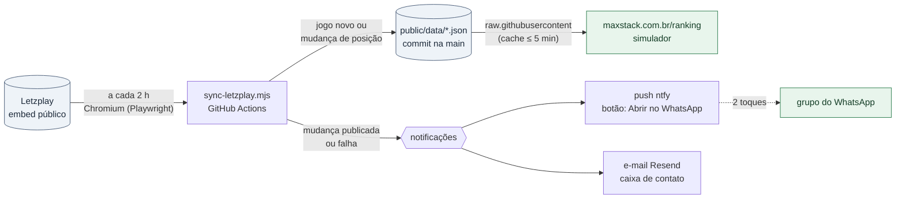

# Master Ibi Aram 2026 · Simulador de chaveamento

Site estático (Vite + React) em `https://maxstack.com.br/ranking/` que mostra a classificação do
6º Ranking Ibi Aram, atualizada do Letzplay de 2 em 2 horas, e monta as chaves das Categorias A e B
conforme o regulamento (`docs/regulamento.md`) e a imagem oficial (`docs/Masters_2026_Chaves.png`).
Visual segue a marca Max Stack (tokens de `site-maxstack`).

Specs: `docs/superpowers/specs/2026-10-18-simulador-chaveamento-design.md` (regras e interface) e
`docs/superpowers/specs/2026-10-18-sync-letzplay-notificacoes-design.md` (sincronização, notificações e decisões).

## O que dá para simular
Ranking e chave ficam na mesma tela (no celular, empilhados, com botão para pular de um ao outro).
- **Trocas de posição**: na tabela, toque num jogador e depois em outro até 5 posições acima.
- **Desistências**: botão "Desiste" na linha. Todos abaixo sobem uma posição; o 9º vira A, o 17º entra na B (regra 4).
- **Resultados**: na chave, toque no vencedor; ele avança até a final. Vaga vazia = W.O., avança automaticamente.
- Tudo fica salvo no navegador (localStorage); a barra de simulação mostra a contagem e zera tudo.
- Seletor de versão no cabeçalho: qualquer classificação já publicada pode ser carregada e simulada.

## Como os dados chegam ao site

- O site publicado lê `index.json`, `ranking.json` e `history/*.json` direto deste repositório
  (`raw.githubusercontent.com/maxstackbr/simulador-master/main/public/data/`, cache de até 5 min).
  Por isso **uma classificação nova não exige deploy do site** e o repositório precisa ser público.
- Em desenvolvimento (`npm run dev`) o site lê `public/data/` local.

## Atualização automática (`.github/workflows/sync-ranking.yml`)
Roda de 2 em 2 horas (cron em UTC) e no botão "Run workflow". A opção `test_notify` do botão só testa as
notificações: dispara push e e-mail com título "🧪 Teste de notificação" e a leitura atual, sem gravar nem commitar nada. Ele:
1. lê classificação e jogos no domínio de embed do Letzplay (`embed.letzplay.me/ibiaram/rankings/47608/{table,matches}`)
   **com o Chromium do Playwright**: a Cloudflare do Letzplay devolve 403 + desafio para curl/fetch em IP de
   datacenter, e limita a taxa, então o sync baixa só o documento (sem imagens/scripts), valida cada resposta e
   tenta de novo em caso de bloqueio. Sem API oficial, o parser (`scripts/lib/letzplay.js`) tem testes com capturas reais;
2. compara com `public/data/ranking.json` e `public/data/matches.json`: jogos novos (só placar aprovado pelo adm;
   W.O. conta como jogo) e mudanças de posição;
3. se mudou, grava nova versão em `public/data` (atual, histórico, índice e `matches.json`) e faz commit na `main`
   como `ranking-bot`, com rebase e novas tentativas caso a `main` tenha andado nesse meio-tempo;
4. **só quando algo mudou e foi publicado, ou a leitura falhou**, notifica com o resumo pronto para o WhatsApp,
   pelos dois canais, independentes entre si (se a publicação falhar, ninguém recebe "atualizado"; o próximo
   ciclo refaz tudo):
   - push via [ntfy](https://ntfy.sh), com os botões "Abrir no WhatsApp" (abre o app com o texto preenchido;
     falta só escolher o grupo e enviar) e "Copiar texto"; em falha, prioridade alta e link para a execução;
   - e-mail para `contato@maxstack.com.br` (Resend) com o mesmo texto.
   Sem mudança, nenhuma notificação.

Para receber o push: instale o app ntfy (Android/iPhone) e assine o tópico definido no secret `NTFY_TOPIC`.
No ntfy.sh o nome do tópico é a única proteção, por isso ele é um secret (mascarado no log público do
workflow), aleatório e nunca aparece em código ou log; para trocar, atualize o secret e assine o novo nome.

Configuração no GitHub (Settings → Secrets and variables → Actions):
- secret `NTFY_TOPIC` (tópico do push; sem ele o push é pulado)
- secret `RESEND_API_KEY` (chave do Resend, só envio; sem ela o e-mail é pulado)
- vars opcionais `EMAIL_TO` (padrão `contato@maxstack.com.br`) e `EMAIL_FROM` (padrão `Ranking Ibi Aram <site@maxstack.com.br>`)

Diagnóstico: cada run deixa em `sync/` (ignorado pelo git) o resumo, o `result.json` e o HTML lido de cada
página. Mudanças no sync devem ser testadas no runner do GitHub, não só localmente: de IP residencial o
Letzplay nem desafia, o que mascara problemas.

## Atualização manual (plano B)
Se o Letzplay mudar o HTML ou a leitura falhar de vez:
1. exporte a planilha do Letzplay e rode `npm run update -- planilha.xlsx --label "Classificação de 1º/dez"`;
2. commit e push na `main`: o site lê os JSON do GitHub.

Planilha esperada: primeira aba com cabeçalho contendo `COLOCAÇÃO`, `JOGADOR`, `SITUAÇÃO`
(só "Ativo" entra na chave) e, opcionalmente, `JOGOS`, `VITÓRIAS`, `DERROTAS`, `APROVEITAMENTO (%)`.

## Publicação do código em maxstack.com.br/ranking
Só necessária quando o código do simulador muda (os dados vêm do GitHub). `npm run build:site` gera o build com
base `/ranking/` e `VITE_DATA_URL` apontando para este repositório, e copia para `site-maxstack/web/public/ranking/`;
o nginx do site serve qualquer arquivo de `web/public` com `try_files`, então o deploy normal do site
(push na `main` do site-maxstack) publica em `https://maxstack.com.br/ranking/` sem mudanças em Caddy, DNS ou containers.

## Comandos
```bash
npm install
npm run dev                 # desenvolvimento (dados de public/data)
npm test                    # vitest: regras da chave, parser do Letzplay (HTML real), payload do push
npm run e2e                 # playwright: telas e regras no navegador, desktop + mobile
npm run sync:dry            # lê o Letzplay e mostra o resumo sem gravar
npm run sync                # lê e grava nova versão em public/data (se mudou); --force grava mesmo sem mudança
npm run update -- caminho/da/classificacao.xlsx --label "Classificação de 1º/dez"   # plano B
npm run build               # dist/ para qualquer host estático
npm run build:site          # build com base /ranking/ e copia para ../site-maxstack/web/public/ranking
```

## Estrutura
- `src/lib/schedule.js` — confrontos, horários e quadras (dados da imagem oficial)
- `src/lib/bracket.js` — regras: trocas, desistências, vagas, avanço de vencedores
- `src/lib/parseRanking.js` — leitura do xlsx (SheetJS), só no plano B
- `src/components/` — Header, RankingTable, Bracket, Match, SimulationBar, ThemeToggle, JumpButton
- `scripts/sync-letzplay.mjs` — leitura com Playwright, detecção de mudanças, gravação e resumo
- `scripts/send-push.mjs` · `scripts/send-email.mjs` — notificações (ntfy, Resend)
- `scripts/update-ranking.mjs` · `scripts/publish-to-site.mjs` — plano B e publicação do código
- `scripts/lib/letzplay.js` — parser do embed, diff de posições e texto para WhatsApp
- `scripts/lib/version.js` — grava versão (atual + histórico + índice) · `scripts/lib/push.js` — payload do ntfy
  · `scripts/lib/html.js` — decodificação de entidades
- `public/data/` — `ranking.json`, `index.json`, `history/`, `matches.json` (fonte do site em produção)
- `test/e2e.spec.js` — regras e telas, contra o snapshot fixo `test/fixtures/e2e-*.json` (os dados reais mudam sozinhos)
  · `test/letzplay.test.js`, `test/push.test.js` — parser e push · `test/fixtures/letzplay-*.html` — HTML real do Letzplay (tabela, jogos, um W.O.)
